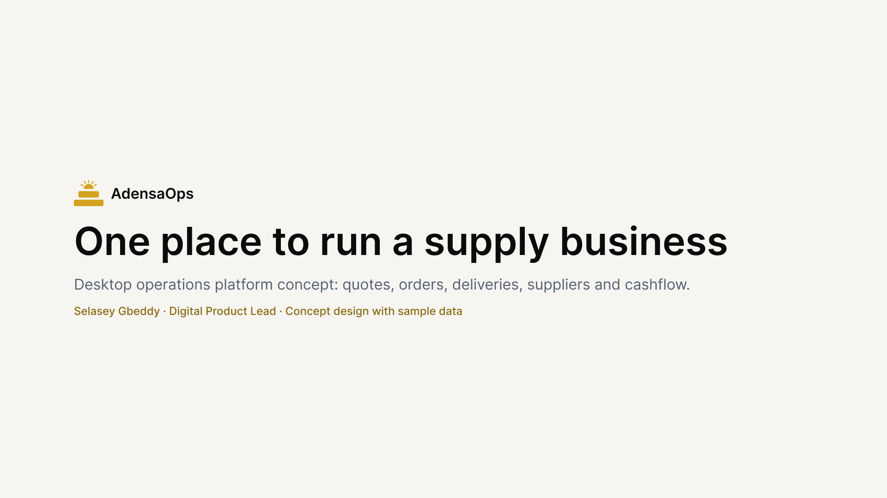
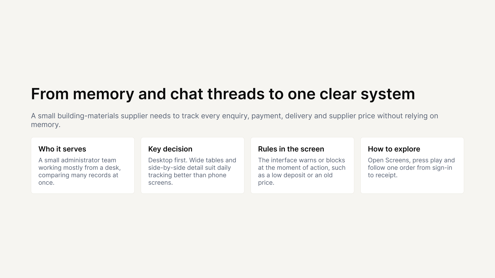
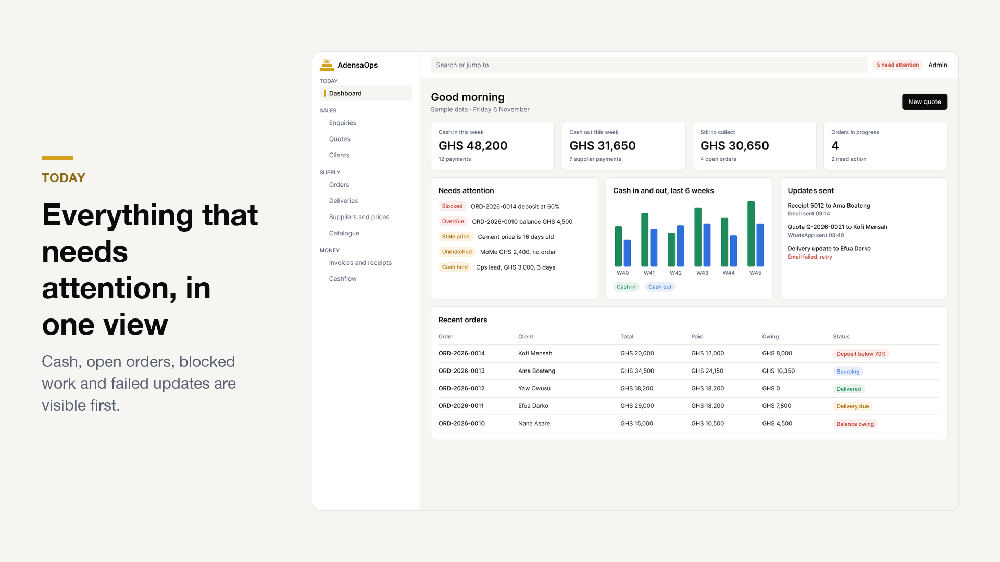
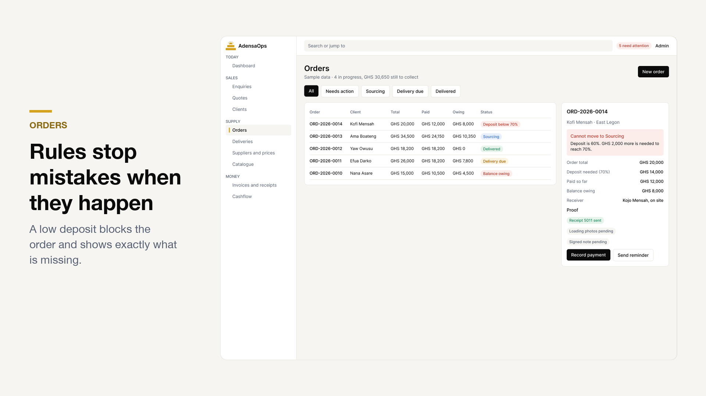
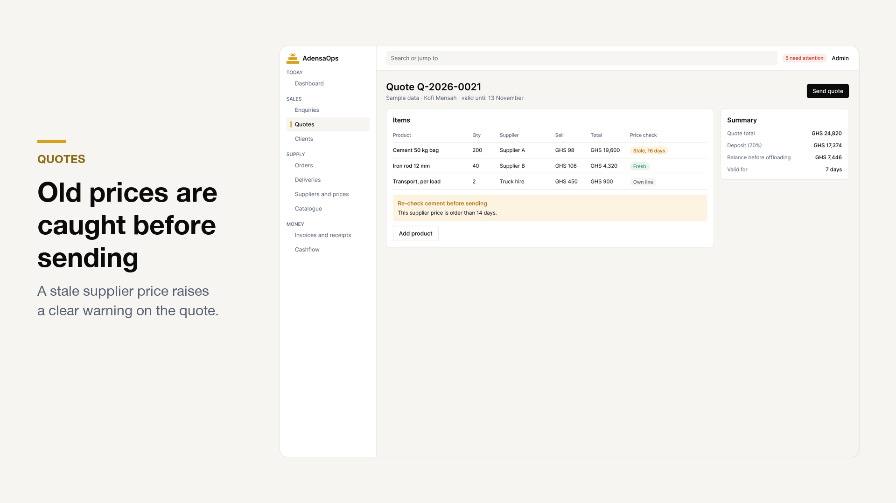
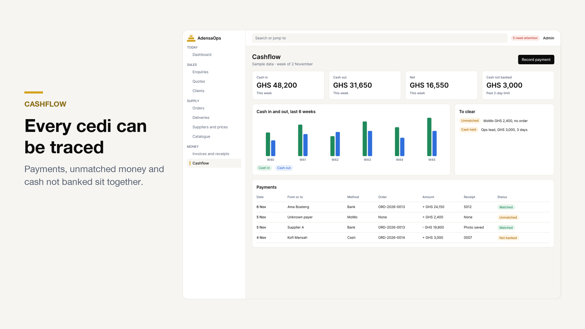
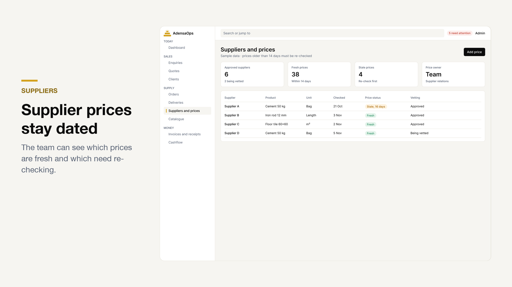

<div align="center">


<a href="https://www.figma.com/community/file/1700529335374306054"></a>
<a href="https://adensaops.com"></a>
<a href="https://selasey-gbeddy.vercel.app"></a>

</div>

> **Concept design with sample data.** All names and numbers are made up.

## The problem

A small building-materials supplier has to track every enquiry, payment, delivery and supplier price. Relying on memory and chat threads does not scale.

## The approach

| Decision | Why |
|---|---|
| **Desktop first** | A small administrator team works mostly at a desk and compares many records at once |
| **Order at the centre** | Quotes, payments, deliveries and receipts all connect to one order |
| **Rules inside the screens** | The interface warns or blocks at the moment of action, such as a low deposit or an old price |
| **Neutral operations look** | Colour is saved for meaning, so problems stand out in dense tables |

## The flow

```text
Sign in → Enquiry → Quote → Order → Payment → Delivery → Receipt
```

Open the Figma file, go to **Screens**, press play and follow one order from start to finish.

## A closer look

<table>
<tr><td width="50%"><br><sub>Concept cover</sub></td><td width="50%"><br><sub>Case study summary</sub></td></tr>
<tr><td width="50%"><br><sub>Dashboard</sub></td><td width="50%"><br><sub>Orders</sub></td></tr>
<tr><td width="50%"><br><sub>Quotes</sub></td><td width="50%"><br><sub>Cashflow</sub></td></tr>
<tr><td width="50%"><br><sub>Suppliers and prices</sub></td></tr>
</table>


---

<div align="center"><sub>Design artefacts only. The demo code lives in <a href="https://github.com/Selaseyjr/adensa-ops">adensa-ops</a>.<br><a href="https://selasey-gbeddy.vercel.app">Portfolio</a> · <a href="https://www.figma.com/@selaseyjr">Figma</a></sub></div>
