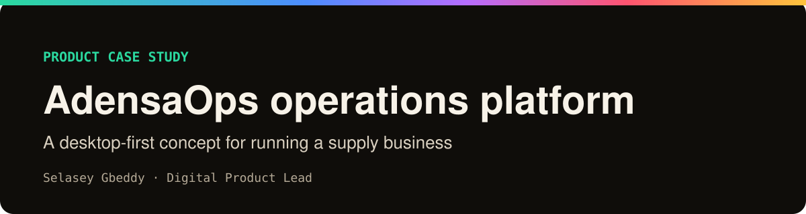
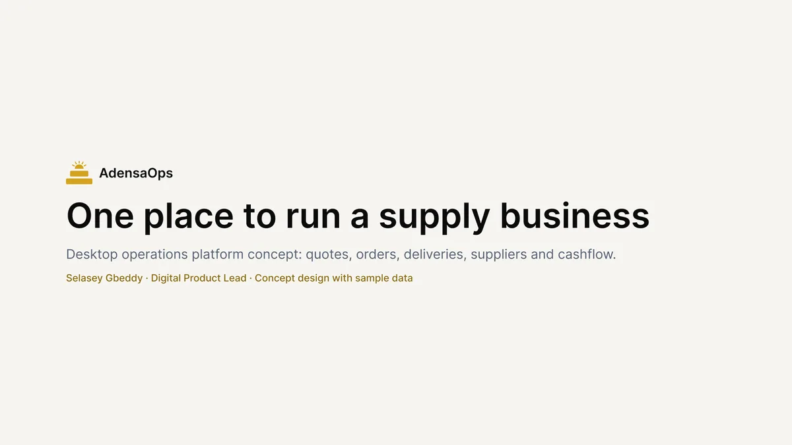

## One screen. The whole operation.

A supply business runs on enquiries, orders, deliveries and cash.

AdensaOps brings them together, with rules that stop mistakes before they happen.

Designed in Figma. Clickable from sign-in to receipt. Sample data.

Design artefacts only. The demo code lives in <a href="https://github.com/Selaseyjr/adensa-ops">adensa-ops</a>. <a href="https://selasey-gbeddy.vercel.app">Portfolio</a> · <a href="https://www.figma.com/@selaseyjr">Figma</a>

